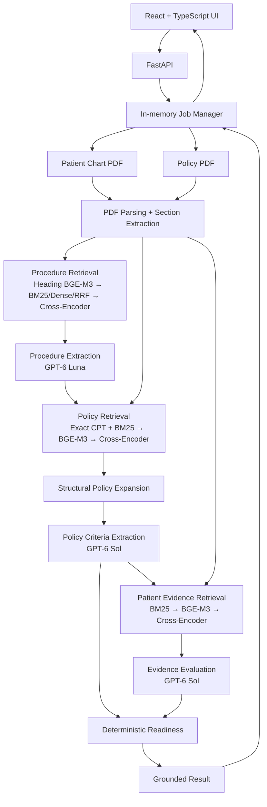

# PriorAuthVerifier

PriorAuthVerifier is a Prior Authorization review tool that compares a patient
chart against an uploaded medical-necessity policy.

It identifies the planned procedure, retrieves the relevant policy criteria,
maps chart evidence to those requirements, evaluates policy exclusions, and
returns a grounded readiness result. It does not submit authorizations to a
payer.

## What It Does

- Upload a patient chart PDF and a medical-necessity policy PDF
- Detect the planned procedure and CPT code
- Retrieve governing policy criteria and preserve AND/OR structure
- Retrieve supporting patient evidence
- Evaluate requirements as MET / MISSING / UNCLEAR
- Evaluate policy non-indications / exclusions
- Produce deterministic readiness: READY, NOT_READY, NEEDS_REVIEW, NOT_APPLICABLE
- Provide grounded citations to chart evidence
- Support an in-session work queue (up to 20 active jobs; default concurrency 2)
- Review completed jobs from the current server session

## Running Locally

**Prerequisites:** Python 3.12+, [uv](https://docs.astral.sh/uv/), Node.js / npm,
and API credentials.

```bash
cp .env.example .env
```

Populate at least `OPENAI_API_KEY`. Set `MISTRAL_API_KEY` if scanned pages need
OCR. `HF_TOKEN` is optional (helps with Hugging Face rate limits).

```bash
make run
```

`make run` (`scripts/run.sh`) syncs Python dependencies, verifies/downloads
local models, installs frontend dependencies from the lockfile, starts FastAPI
and the React/Vite frontend, and shuts both down together with Ctrl+C.

| Service | URL |
|---|---|
| Frontend | http://localhost:5173 |
| API | http://localhost:8000 |
| Swagger | http://localhost:8000/docs |
| Health | http://localhost:8000/health |

Ports 8000 and 5173 must be available.

## Architecture

Request-scoped, in-memory pipeline. No vector database, Redis, Celery, or
persistent application database.



Default models (configurable in `.env`): `BAAI/bge-m3`,
`BAAI/bge-reranker-v2-m3`, `gpt-6-luna` (procedure), `gpt-6-sol`
(policy/evidence), `mistral-ocr-latest` (OCR fallback when page text is
insufficient).

## Analysis Flow

### 1. Procedure detection

Patient chart is parsed once and segmented. Headings are ranked with BGE-M3;
selected sections are chunked; hybrid BM25 + dense retrieval with RRF and
cross-encoder reranking feeds GPT-6 Luna for structured procedure/CPT
extraction.

### 2. Policy criteria extraction

Policy is parsed once. Exact CPT search and BM25 produce candidates; BGE-M3 and
the cross-encoder identify governing sections. Local structural expansion builds
context, then GPT-6 Sol extracts the criteria tree (AND/OR groups, conditions,
non-indications/exclusions).

The uploaded policy is the source of truth. Patient payer identity is not
compared against the policy publisher.

### 3. Evidence evaluation

For each requirement, patient sections are retrieved, dense-scored, and
reranked. GPT-6 Sol evaluates evidence as MET / MISSING / UNCLEAR using only
that criterion’s retrieved candidates. Exclusions are evaluated separately.
Final readiness is computed in code from the evaluated policy tree.

## Using the App

1. Open http://localhost:5173
2. Upload a patient chart PDF
3. Upload a policy / guideline PDF
4. Click **Start verification**
5. When a case completes, open it with **Review**

Multiple cases may be submitted without waiting for the previous case to finish.
Job history is retained for the current server session.

**Queue:** `MAX_ACTIVE_ANALYSIS_JOBS` (default `20`) caps `QUEUED` + `RUNNING`
jobs. `ANALYSIS_JOB_CONCURRENCY` (default `2`) limits simultaneous execution;
remaining jobs wait in `QUEUED`. States are `QUEUED` → `RUNNING` →
`COMPLETED` | `FAILED`. Completed/failed jobs remain in session history and no
longer count toward the active limit. Temporary uploaded PDFs are deleted after
completion or failure; filenames and results stay in memory until the server
process exits.

The application accepts up to 20 active jobs while using bounded execution
concurrency to avoid saturating local model inference resources.

## API

| Method | Endpoint | Purpose |
|---|---|---|
| `POST` | `/api/jobs` | Submit a case; returns immediately (`202`) |
| `GET` | `/api/jobs` | List session jobs (newest first) |
| `GET` | `/api/jobs/{job_id}` | Job metadata; includes result when completed |
| `POST` | `/api/analyze` | Synchronous analyze (compatibility / tests) |
| `GET` | `/health` | Health check |
| `GET` | `/ready` | Configuration readiness (`OPENAI_API_KEY`) |

Full schemas: http://localhost:8000/docs

## Development

Run all checks (backend lint/types/tests and frontend build/tests):

```bash
make check
```

Install local pre-push protection once:

```bash
ln -sf ../../scripts/pre-push .git/hooks/pre-push
```

After that, every `git push` runs the same validation. GitHub CI runs the same
`make check` command on pull requests and pushes to `master`.

## Testing

`make check` is the canonical validation command. Individual steps:

```bash
uv run ruff check .
uv run mypy app
uv run pytest
```

```bash
cd frontend
npm run build
npx playwright install chromium   # first browser-test run only
npm test
```

Latest results from this workspace:

| Check | Result |
|---|---|
| `ruff check .` | passed |
| `mypy app` | passed |
| `pytest` | 303 passed, 4 skipped |
| `npm run build` | passed |
| `npm test` | 19 passed, 1 skipped (opt-in live UHC test) |

Frontend browser tests mock the API unless `RUN_LIVE_UHC=1` is set.

## Design Decisions

**No vector database.** Documents are request-scoped; embeddings stay in memory
for the analysis.

**Hybrid retrieval.** BM25 provides lexical recall; BGE-M3 provides semantic
matching. Cross-encoder reranking improves precision before LLM evaluation.

**Deterministic readiness.** LLMs extract/evaluate grounded policy information;
final readiness is computed in code from structured results.

**Bounded job concurrency.** The local cross-encoder workload is CPU-intensive,
so the queue allows many submitted jobs while limiting simultaneous execution.

**In-memory job history.** Appropriate for the take-home; avoids persistence
infrastructure that is not required for the workflow.

## Limitations

**Cold-run latency.** Large unseen policies are expensive. On the provided
~3,655-page policy, a cold analysis took roughly four minutes on the development
machine. Main costs: CPU cross-encoder evidence reranking, GPT-6 Sol policy
extraction, and policy parsing/candidate embedding to a lesser extent.

**In-memory job history.** Metadata and results exist only for the FastAPI
process lifetime. Restart clears the queue and history.

**Local execution concurrency.** Submitting many jobs does not execute them all
at once; only `ANALYSIS_JOB_CONCURRENCY` analyses run simultaneously.

**LLM structural variability.** Structured policy extraction can vary slightly
between runs in the number or shape of atomic criteria. In validation runs, the
governing policy match, key exclusion behavior, and final readiness remained
stable.

**Uploaded policy quality.** Depends on parsable policy text. Mistral OCR is a
fallback for pages with insufficient extracted text; complex/scanned layouts may
still reduce quality.

**No persistent application database.** No durable case history, users,
organizations, or audit store. Uploaded files are processed for analysis;
temporary PDFs are deleted after the job finishes. Persistent case storage is
not implemented.

**No direct payer submission.** Evaluates documentation against an uploaded
policy. Does not submit prior authorizations, guarantee approval, verify payer
portal state, or replace clinical judgment.

**No EHR integration.** PDFs are manually uploaded; there is no EHR/FHIR
connection in this take-home.

## Production Improvements

Future work, not implemented here:

- Pre-index/cache stable policy documents by content hash
- Persist jobs/results in a database
- Run analysis workers independently from the API and scale them separately
- Use accelerated/batched reranking and benchmark narrower candidate routing
  against a retrieval regression set
- Add authenticated EHR/payer integrations and durable audit logging where
  required

## AI Tool Usage

AI coding tools were used for implementation assistance, refactoring, debugging,
and test generation. I designed and reviewed the retrieval architecture,
policy/evidence workflow, grounding constraints, deterministic readiness logic,
job orchestration, and validation strategy. Generated changes were manually
reviewed and validated with automated and end-to-end tests.
